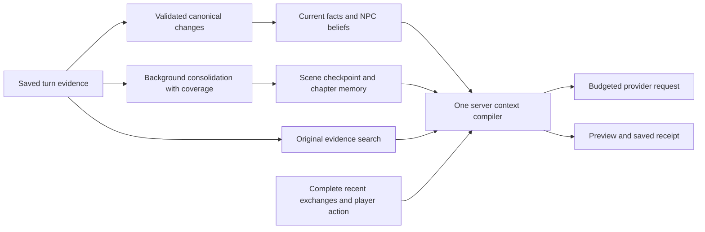

# Mtherios agent harness review — September 6, 2026

Mtherios should keep its server orchestrator and canonical PostgreSQL database, and adopt specific memory and context-management techniques from other harnesses. The largest opportunities are reliable memory formation, a larger usable recent-dialogue window, temporal consistency, and controls that explain and change the actual server request. Replacing the framework would leave these application-specific problems to solve again.

This is an architecture review and implementation roadmap. Application code, saved provider settings, and campaign records were not changed in this pass. The working tree already contains substantial ongoing changes; the review accounts for the September 5 implementation instead of proposing those features as new work.

## What was checked

- Current source, project architecture guidance, and the previous implementation report.
- Live app status, a read-only Veil prompt diagnostic at three context budgets, and the browser's story, Technical, and Memory settings surfaces.
- Current primary documentation for Anthropic's harness designs, LangGraph, Letta, Hermes, and Graphiti.
- Focused prompt-harness, retrieval, and receipt tests: **71 passed across three files**.

[Measurement evidence](evidence/agent-harness-review-2026-09-06.json) contains counts and hashes without copying campaign prose. Diagnostic requests are previews, not captured provider requests: the current diagnostic path omits wiki context and does not use the normal turn's complete scene hints, visibility options, or timeout handling. The saved browser receipt was inspected separately.

## Framework comparison

The application recommendations in the last column are engineering judgments based on Mtherios's existing architecture. No external framework was installed or benchmarked here.

| Framework or harness | Useful design | Application to Mtherios |
| --- | --- | --- |
| Anthropic context engineering and long-running harnesses | Curate context continuously; preserve critical state across compaction; maintain explicit progress artifacts and verify outcomes. | A source-linked scene checkpoint plus recent complete exchanges; measurable recall checks before older material leaves active context. Use existing jobs and replay tests. [Context engineering](https://www.anthropic.com/engineering/effective-context-engineering-for-ai-agents), [long-running harnesses](https://www.anthropic.com/engineering/effective-harnesses-for-long-running-agents). |
| LangGraph | Separate checkpointed conversation state from durable, namespaced memory; choose whether writes happen during a request or in the background. | Scope memory by campaign and branch, persist the completed processing position, and make restart/retry behavior explicit. Existing PostgreSQL rows and outbox jobs already provide much of this foundation. [Memory concepts](https://docs.langchain.com/oss/javascript/concepts/memory). |
| Letta | Inspectable persistent memory and background consolidation of recent conversations. | Consolidate promises, relationship changes, learned facts, and unresolved actions between turns. Run through the existing proposal and validation path; expose what changed and its evidence. [Memory and dreaming](https://docs.letta.com/configuration/memory). |
| Hermes | Small persistent notes, full-history message search, and context-pressure management with cache-aware boundaries. | Keep a compact campaign/scene state, then let the existing GM tools find and open original evidence when recall is insufficient. Preserve the newest dialogue; avoid freezing changing scene facts in the stable prompt prefix. [Persistent memory](https://hermes-agent.nousresearch.com/docs/user-guide/features/memory/), [compression and caching](https://hermes-agent.nousresearch.com/docs/developer-guide/context-compression-and-caching). |
| Graphiti / Zep | Temporal validity and provenance; retrieval across keywords, semantics, and relationships. | Make “true now,” “formerly true,” “someone believes this,” and “planned” explicit across agreements, memories, and summaries. Extend existing supersession metadata and SQL relationships before considering a separate graph service. [Graphiti](https://github.com/getzep/graphiti). |

The common lesson is that stored history, working context, authoritative state, and background memory formation have different jobs. More agents or another database will not automatically improve any of them.

## Findings, in priority order

### 1. Memory formation can fail while narration continues

The app reported **56 failed jobs globally**. The scoped Veil check at 18:25 UTC reported **50 failed `extract_turn_state` jobs**, with no ready or running jobs. The latest displayed failures report a provider rejection of disabling reasoning for GLM 5.3. These are recorded failures; this review did not establish whether every error remains reproducible under the latest source and deployed build.

Narration can still be stored and searchable when extraction fails. The specific risk is missing structured consequences, relationships, beliefs, and agreements. Successful prose generation is therefore insufficient evidence that long-term memory is current.

**Change:** show the last contiguous successfully processed turn and any gaps; validate the effective classifier request against provider capabilities; replay eligible failed jobs through the existing guarded retry path after proving the cause fixed. Preserve their original sources and partial application receipts. Do not treat a high maximum processed turn as proof that all earlier turns succeeded.

**Acceptance:** a forced provider failure leaves the transcript intact, displays a memory gap, survives restart, and retries once without duplicate canonical changes. The coverage indicator becomes current only when every required gap is resolved.

Relevant paths: `src/lib/server/jobs/processor.ts`, `src/lib/server/jobs/outbox.ts`, `src/lib/server/turn/provider.ts`, and the existing jobs recovery UI.

### 2. More context currently does not mean more recent conversation

| Requested scene/memory budget | Actual dialogue | Messages | Scene/memory tokens |
| --- | ---: | ---: | ---: |
| 8,000 | 4,237 | 16 | 6,567 |
| 48,000 | 4,237 | 16 | 6,567 |
| 200,000 | 4,237 | 16 | 6,567 |

All three dialogue hashes matched. Source explains why: `renderEntries` uses a fixed **4,800-token allowance**, clips user messages at **1,000 characters** and narration at **3,200 characters**, then selects history. A larger scene/memory budget cannot recover text already clipped there. The newest user/assistant suffix can also exceed that allowance; a current regression test explicitly expects an oversized example to exceed 12,000 tokens. That is a soft selection limit, not an enforced request limit.

**Change:** provide an effective server dialogue allowance, initially evaluating **8K, 12K, and 24K** against the same replay cases. Retain complete recent exchanges when they fit; compact older material only when necessary. Preserve both the setup and final beat of an oversized latest exchange, count omission markers, and keep source IDs for omitted portions. Respect parallel POV boundaries when grouping exchanges.

Before increasing defaults, enforce a total request budget covering instructions, dynamic context, history, action, tool schemas/results, output reserve, and provider overhead. Prefer provider-reported capacity or an explicit override over an unknown model-name guess. A small local model must receive a valid bounded request too.

**Acceptance:** increasing dialogue allowance retains an exact promise from the middle of an older conversation; multilingual/oversized messages remain bounded; private thoughts and POV context keep their knowledge restrictions; the saved receipt matches the provider-bound payload. The best allowance is selected by recall and narrative quality, not maximum token utilization.

Relevant paths: `src/lib/server/turn/promptPacket.ts:970`, `src/lib/server/turn/orchestrator.ts:2527`, `src/lib/services/ai/context/modelWindows.ts`, `src/lib/services/backendClientContext.ts`.

### 3. Slow optional embeddings can remove otherwise usable recall

Inside `candidateNodes`, broad memory, text matches, vector matches, beliefs, events, and transcript recall are largely awaited sequentially. Vector lookup occurs before the transcript search. Remote embedding fetches have no cancellation signal in this module. The outer narrator retrieval deadline can return an empty packet while that work continues.

This is a code-path risk, not a reproduced live outage: the active embedding provider is currently `local-hash`.

**Change:** start independent retrieval sources together; give optional semantic retrieval a cancellable sub-budget; preserve completed lexical, canonical, and transcript candidates when semantics times out. Record which source was unavailable. Keep visibility and control-message filtering before candidate caps. A deadline should reduce recall coverage gracefully rather than silently replace every source with nothing.

**Acceptance:** with an embedding request deliberately stalled, an old source-linked promise still reaches the narrator before the outer deadline; the cancelled request stops; no secrets or foreign-story records appear. Measure warm/cold p50 and p95 on a restored large campaign as well as small fixtures.

Relevant paths: `src/lib/server/memory/retrieval.ts:372`, `src/lib/server/memory/embeddings.ts:60`, `src/lib/server/turn/orchestrator.ts:2403`.

### 4. Temporal consistency needs enforcement across all consumers

The browser displayed multiple agreements whose terms explicitly say they are historical and superseded under the **active** list. The agreement selector admits active/contested records. Meanwhile, memory ranking already understands several supersession identifiers and statuses. These mechanisms need consistent producer and consumer behavior.

**Change:** use validated status changes and supersession/source links when an obligation or relationship changes. Preserve the original historical record. A narrator query about the present should prefer the current state; a query about an old event should still retrieve the historical evidence. Keep NPC belief separate from objective truth. Do not solve this with a prose regex that globally deletes anything mentioning “superseded.”

**Acceptance:** after an annulment or completed obligation, the old agreement remains searchable but cannot reappear as a current duty. A character can remember the former relationship without treating it as current. Export/import and summary rebuilds retain the distinction.

Relevant paths: `src/lib/server/turn/promptPacket.ts:1090`, `src/lib/server/memory/ranking.ts:173`, `src/lib/server/memory/canonical.ts`, and existing agreement contracts and UI.

### 5. Semantic recall needs a controlled comparison

`local-hash` constructs deterministic token/bigram features; it is useful as a cheap lexical signal, but it does not provide a learned semantic understanding of paraphrases. The [previous implementation results](project-improvement-implementation-results-2026-09-05.md) report 26/27 retained answers in both local-hash and embeddings-disabled modes, with a remaining paraphrase case. Those are prior recorded measurements, not rerun results from this review.

**Change:** use the existing `bench:memory` harness to compare local hash, lexical-only, and a real embedding model on a disposable copy. Expand evaluation with aliases, implicit callbacks, recurring NPCs, corrected facts, and old promises. Preserve the existing lexical fallback. Rebuild a separate model/version-specific vector projection for the experiment; matching vector dimensions alone does not make different embedding spaces compatible.

**Acceptance:** better recall on held-out paraphrases, no visibility regressions, and measured latency/cost within an agreed limit. Keep the provider change separate from the comparison; publish results before selecting a new default.

Relevant paths: `scripts/bench-memory.mjs`, `evals/memory/`, `src/lib/server/memory/embeddings.ts`, and existing embedding settings.

### 6. The UI should expose effective memory, coverage, and evidence

The current Memory tab presents Conversation Messages, Raw History Scan, and Dynamic Prompt Cap as live controls. `buildBackendClientContext` does not send those three values to the server narrator. Its fixed server limits can therefore differ from what these controls suggest. The browser also has useful saved receipts and guarded job recovery already; those should be extended.

**Change the existing controls and panels:**

- Show a small story-level status: **Memory current**, **Updating**, or **Needs attention**, derived from processing gaps. Open the existing recovery view from that status.
- Put server-effective **Recent dialogue**, **Retrieved history**, and **Total request limit** controls together. Label browser-only settings clearly or hide them for server-bound stories. Save scope and pending/error state should be visible.
- Add a **Next turn preview** beside **Last sent**. Both should use the same server preparation logic, while preview avoids generation and canonical writes. Today the debug builder is a separate approximation.
- Extend “What reached the narrator” with full versus clipped source text, why it was chosen, its source turn, and a jump to the original evidence. Current dialogue receipts count selected excerpts as sent even if earlier character clipping removed part of the original message.
- Show current and historical agreements separately. Make a correction a source-linked proposal applied through the existing validator.
- Label the existing **96% cache hit** display as application cache reuse. Display provider cached-input tokens separately when reported; local cache hits do not establish provider cost savings.
- Add proper accessible labels to the Memory sliders and number inputs. The inspected accessibility tree exposes several as unnamed controls. Keep receipt details collapsed during ordinary play.

## Proposed implementation sequence

| Phase | Concrete result | Release gate |
| --- | --- | --- |
| 1 — Reliable retention | Diagnose current extraction failures; coverage/gap status; bounded independent retrieval with cancellation. | Failure/retry/restart tests and a stalled-embedding retrieval test; source-linked recall remains available. |
| 2 — Larger useful working context | Effective dialogue budget, complete-exchange retention, total request guard, correctly wired settings and saved receipt. | Same scenes compared at 4.8K/8K/12K/24K; no lost decisive middle facts or request overflows. |
| 3 — Current versus historical truth | Consistent agreement/fact supersession, historical lookup, belief boundaries. | Time-skip, annulment, fulfilled-promise, rumor-correction and import/export replay cases. |
| 4 — Scene continuity between windows | A bounded scene checkpoint with source range, scene/POV ID, current participants, known facts, unresolved question, commitments, last completed beat, and processing version. | Restart after 100+ turns; late jobs cannot overwrite a newer scene; missing checkpoint falls back to source evidence. |
| 5 — Recall quality and UI polish | Embedding comparison, evidence navigation, faithful next-turn preview, measured latency/cache display. | Held-out recall gains, browser acceptance, and actual provider-bound request/receipt agreement. |

For phase 4, first extend the existing story metadata/checkpoint and background-job paths. Keep a checkpoint plus the exact turns after its covered position. Rebuild it after edits, deletion, branch changes, or relevant canon revisions. Store one checkpoint per active scene/POV when needed. A failed consolidation must leave its source transcript available; a generated checkpoint is a derived projection, never a replacement for canonical state.

The existing 71 tests passing is a useful baseline, not proof of better story behavior. Add behavioral replay cases at the identified failure boundaries, then compare the actual narrator's adherence on the same fixed scenarios. In particular, score repeating a settled question, confusing past and current relationships, forgetting an old obligation, and leaking another POV's private knowledge. Track recall and unsupported assertions separately from prose preference and response latency.

My first implementation slice would combine phase 1's retrieval isolation with phase 2's effective dialogue controls and request guard. Reliable memory coverage should be visible in that same release. Temporal corrections and scene consolidation follow through the existing canonical write paths; adopting another agent framework is unnecessary for those improvements.
