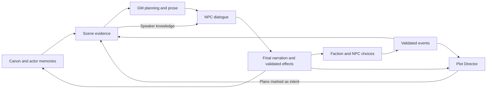

# Sol implementation handoff: context, prose, Director, and factions

- Date: 2026-09-27
- Status: **Implementation in progress.** See [the dated evidence report](context-harness-implementation-report-2026-09-27.md) for completed work and open qualification gates.
- Checkout: `E:\DEV\Projects\MythEngine`
- Intended implementer: Sol, continuing in this checkout with the user's chosen model/settings.

## Assignment

Implement the phases below so faction and NPC decisions, the Plot Director, GM planning, narration, dialogue, and memory form one reliable causal loop. Carry the full checklist through verification. If a phase remains incomplete, retain it explicitly; passing a subset of tests does not complete this objective.

Read [AGENTS.md](../AGENTS.md) and the relevant sections of [ARCHITECTURE.md](../ARCHITECTURE.md). Recheck current implementation before editing: this plan records a source audit, and the checkout contains extensive unrelated modified and untracked work. Preserve that work. Routine implementation choices belong to the implementer; missing information is a reason to ask only when it changes the outcome or authorization.

The current request authorizes writing this plan. Execute it when the user hands it off for implementation. Do not interpret this document as permission to replay a real campaign, rewrite historical canon, switch providers, or spend on model evaluations. Use the actual implementation session's authorization for those actions.

## Observable result

An NPC or faction makes a supported choice; the world records its accepted effects; the Director selects relevant developing pressure; the GM and dialogue model receive consistent scene evidence; final narration establishes what happened; validated extraction updates memory, knowledge, commitments, and thread state. The next turn reflects those consequences and does not present completed pressure as new.



Use the existing canonical records, source references, server preparation, run ledger, extraction jobs, and validators. A shared evidence structure should have separate views for GM knowledge, actor knowledge, and player-visible material. No new agent framework, memory database, mandatory critic call, or competing turn writer is needed.

Preserve the experience already requested: NPC biography, appearance, persona, goals, and memories; current world/scene state; arcs; chapters not represented by those arcs; and up to 20 recent entries outside the latest chapter boundary. Relevance and whole-record budgeting determine what fits. Keep the optional dialogue service focused on NPC speech and brief delivery while the GM owns facts, actions, and scene prose.

## Audit baseline and source map

These are observations from the 2026-09-27 audit, not claims that fixes have shipped. Line numbers may move; use the named functions and source paths.

| Gap | Current owner / anchor | Evidence to preserve in a regression |
| --- | --- | --- |
| Non-Jev faction advancement IDs collide | [processor.ts](../src/lib/server/jobs/processor.ts), `event_world_tick` identity around 2215; [autonomy.ts](../src/lib/server/factions/autonomy.ts), `buildFactionMovePlan` | Low-pressure progress increments by 0.1 but ID uses `floor(progressAfter * 4)`. Actual planner reproduction reached 0.3, then rejected the proposed 0.4 on repeated eligible ticks. |
| Automatic closure leaves Director pressure active | [processor.ts](../src/lib/server/jobs/processor.ts), `persistChapterThreadPlan`; [strategicFramePromptCard.ts](../src/lib/services/ai/context/strategicFramePromptCard.ts); [plotBrainFreshness.ts](../src/lib/services/ai/context/plotBrainFreshness.ts) | Chapter closure sets `needsDevelopment`, but does not perform the manual editor's pressure cancellation or `closedThreadIds` update. |
| Wording is treated as event completion | [timeline.ts](../src/lib/server/events/timeline.ts), `acknowledgedDueEventIdsFromNarration`; [orchestrator.ts](../src/lib/server/turn/orchestrator.ts), narrated event commit | A conditional bread-price increase was acknowledged; an enacted increase expressed as doubled loaf prices was missed. |
| Planner lacks recent conversational sequence | [agentRuns.ts](../src/lib/server/engine/agentRuns.ts), `planNext` | It sends a dynamic-context prefix and action, but omits `prepared.prompt.messages`. The narrator receives these messages separately. |
| Dialogue drops learned beliefs and lacks speaker identity | [dialoguePass.ts](../src/lib/server/turn/dialoguePass.ts); [promptPacket.ts](../src/lib/server/turn/promptPacket.ts) | Actual selected beliefs are tagged `beliefs`; dialogue selects `requiredBeliefs`, which contains initiative fields. Quote matching has no actor ID. |
| Final request can overflow after successful tools | [orchestrator.ts](../src/lib/server/turn/orchestrator.ts), dynamic budget and later specialist context; [provider.ts](../src/lib/server/turn/provider.ts) | Initial budget excludes later tool/actor observations. Provider guard rejects the final overflow. |
| Director loses causal dossiers before redundant history | [strategicWorldBrainInput.ts](../src/lib/services/ai/context/strategicWorldBrainInput.ts); [serviceCommands.ts](../src/lib/server/engine/serviceCommands.ts) | Prefix truncation follows history before faction/actor dossiers; current-arc and recent chapters overlap. |
| Faction choices weakly reflect player consequences | [processor.ts](../src/lib/server/jobs/processor.ts), target selection and Jev packet around 1706/2168 | Target choice and evidence omit much relevant geography, relationships, and recent causal events. |
| Existing replay misses the combined path | [eval-turns.mjs](../scripts/eval-turns.mjs); [replayRunner.ts](../src/lib/server/evals/replayRunner.ts) | Replay calls `processServerTurn` directly, disables workers, and uses short fact/state checks. Real-model mode also retains synthetic cost/cache assertions. |

The audit ran 51 passing tests across dialogue, timeline, Jev faction autonomy, Director lifecycle, and replay scoring. Those tests did not cover the reproduced gaps. The saved latest Journey narration receipt used about 8,282 estimated tokens without global truncation; its dialogue pass fell back after a 45-second timeout. Zero actor cards in that sample involved an unnamed official and newly generated captains, so do not label that observation a proven budget bug. The HTTP app was unavailable during the audit; saved receipts and database reads supplied runtime evidence.

Existing [memory/context consolidation](mythengine-memory-context-consolidation-plan-2026-09-23.md) and [turn-memory redesign](turn-memory-extraction-redesign-plan-2026-09-24.md) documents contain broader, partly implemented work. This plan does not require completing those whole roadmaps. Reuse their implemented owners; do not recreate retired Style Review or duplicate `extract_turn_state`.

## Phase 0 — Establish the baseline and regression fixtures

1. Record `git status --short`, the changed files relevant to this plan, and current source identity. Do not reset, clean, or broadly stage the checkout.
2. For runtime work, inspect `npm run app:status` and `npm run app:config`; verify actual process, port, artifact, data root, worker setting, and database. Never infer them from the working directory or this audit's old process IDs.
3. Capture a compact baseline from saved receipts: requests/tokens by service, retained actor/event/thread IDs, dialogue outcome, extraction coverage, and Director/faction state. Avoid dumping complete prompts or terminal logs when a field summary suffices.
4. Add the smallest meaningful failing fixtures for phases 1–3. Use synthetic IDs and a disposable database or mocks. A test may not use a production database merely because an integration environment variable is enabled.
5. Record every phase and its acceptance status in a dated implementation report. Keep this document labeled as the plan.

**Gate:** each concrete failure has a reproducible fixture, or a documented current-source reason it no longer exists. The baseline distinguishes source, tests, saved historical receipts, and current live behavior.

## Phase 1 — Restore deterministic faction progress and plot closure

### 1A. Advancement identity

- Change faction advancement identity to represent one eligible project action: project ID plus expected prior revision/progress and due action step, or an equivalent existing canonical version. Use an identity stable across retries and distinct across successive accepted advances. Do not substitute a random ID or wall-clock timestamp.
- Revalidate project state under the existing transaction/lock before applying progress and effects. A stale concurrent candidate must not advance the project twice.
- Keep the current Jev and deterministic branches compatible. Preserve existing events; no historical regeneration is required.

**Acceptance:** a low-pressure project progresses beyond 0.3 to completion across eligible ticks; retrying one tick creates no duplicate event/progress; two stale concurrent attempts accept at most one advancement; a hold leaves progress unchanged.

### 1B. Shared closure behavior

- Reuse or extract the small transactional closure behavior in [plotEditing.ts](../src/lib/server/engine/plotEditing.ts), including `removeThreadPressure`, closed-thread suppression, and linked future-event cancellation. Do not call a user-facing edit command recursively from a background transaction.
- Apply it from automatic chapter/thread resolution as well as manual editing. Preserve closure provenance: a chapter resolution is not a player veto, and a player-closed thread cannot be reopened by automatic reconciliation.
- Remove only future pressure belonging to the closed thread. Preserve committed events, their source links, unrelated pressure, and pending-versus-applied frame identity. Use the existing cancellation/link cleanup rules.
- Ensure the next prepared prompt observes the closure even when the Director worker is delayed or fails. Replanning may enrich later guidance, but it must not be required to stop a closed thread.

**Acceptance:** close/abandon a thread, delay replanning, and verify the next prompt excludes its active card and future beats. Existing history remains. Repeating closure is idempotent; a stale pending frame cannot restore closed pressure.

**Likely tests:** [projects.test.ts](../src/lib/server/factions/projects.test.ts), [autonomy.jev.test.ts](../src/lib/server/factions/autonomy.jev.test.ts), [chapterThreads.test.ts](../src/lib/server/plotBrain/chapterThreads.test.ts), [plotEditing.test.ts](../src/lib/server/engine/plotEditing.test.ts), and a focused job persistence test.

## Phase 2 — Reconcile narrated consequences through evidence

1. Extend the existing extraction contract with bounded feedback for due event IDs: an explicit outcome and an exact supporting span from the **final persisted narration**. Distinguish actual occurrence, a surfaced signal, deferral, and uncertainty. Define how each receipt maps to existing canonical event/thread statuses; a surfaced rumor does not complete its underlying planned event.
2. Capture the bounded due-event candidates actually sent for that turn, including scope, relevant revision, and source identity. Save this snapshot and the final narration fingerprint in the existing extraction job/receipt. A delayed worker must not evaluate a newly scheduled event against an older narration.
3. Route the feedback through both synchronous and deferred extraction. Inspect `shouldExtractDurableState`, operation counts, no-operation exits, historical filtering, and `enqueueTurnStateExtractionJob`. A feedback-only turn must not be skipped merely because it has no inventory/character patch. If extraction is disabled or output is ambiguous, preserve an explicit unresolved receipt and do not commit by word overlap.
4. Validate candidate membership, story/branch/POV scope, source text, source fingerprint, expected prior status/version, and supported outcome. Quote existence alone is not semantic proof: conditional, reported, historical, and hypothetical statements must not be accepted as new events.
5. Apply accepted effects in the existing locked canonical transaction. Link the final narration entry and any accepted belief/thread changes. Retry delivery must not duplicate effects or overwrite a later source.
6. Remove keyword acknowledgment as an authoritative commit gate. It may remain an advisory candidate detector if useful. A pending extraction should leave the event uncommitted while the next scene context carries the already-narrated evidence and pending reconciliation, so it is not automatically replayed as a fresh beat.
7. If dialogue or a roll continuation changes the draft, discard evidence spans from the earlier draft and validate against the final text. Reuse the current inline-memory invalidation behavior; do not enable an optional experimental footer as a prerequisite.

**Acceptance:** direct, paraphrased, conditional, quoted-report, historical, negated, and uncertain cases produce the correct receipt/status. Test worker delay, feedback-only extraction, retry, later canon changes, and final dialogue edits. One realized event stays realized on the next turn; a rumor remains a rumor; another POV's event is not exposed or applied.

**Owners:** [schemas.ts](../src/lib/services/ai/tools/schemas.ts), [patchValidator.ts](../src/lib/server/turn/patchValidator.ts), [orchestrator.ts](../src/lib/server/turn/orchestrator.ts), [outbox.ts](../src/lib/server/jobs/outbox.ts), [processor.ts](../src/lib/server/jobs/processor.ts), [timeline.ts](../src/lib/server/events/timeline.ts). Extend existing schemas and metadata before adding storage.

## Phase 3 — Share scene evidence and preserve each speaker

### 3A. GM planner and narrator

- Build role-appropriate views from the existing prepared context and source records. Preserve source IDs, visibility, branch/POV, current truth versus history, and intent versus occurrence. Keep the helper small and within the current turn/context owner.
- Bind the shared evidence to story/game, canonical revision, branch/POV, scene, and participant IDs. Read-only tool rounds may reuse it; accepted writes, player answers, or changed source revisions must refresh the affected view before the next decision.
- Give the planner the current action, recent exchange sequence, scene/participants, current commitments, active relevant Director pressure, recent causal faction effects, and validated observations. Replace arbitrary prefix slicing with whole-record selection.
- A short response such as "I accept" must include the offer it answers. Retain the existing six-call limit, multi-call batching, pause barriers, durable continuation, settings checks, and fallback behavior.
- Unnamed or ambiguous speakers may use a scene-local identity until canon resolves them. Do not invent a permanent actor ID, overwrite a similarly named character, or require every incidental speaker to become canon.

### 3B. Actor memory and dialogue

- Reuse [gmTools.ts](../src/lib/server/engine/gmTools.ts) actor evidence rather than scraping a large prompt string. A speaker view should include identity/portrayal, bio/appearance as relevant, persona/voice, current intent, constraints, selected learned beliefs, witnessed events, and commitments with source IDs.
- Rank memory candidates within each selected actor before global caps: current topic/action, commitment links, importance, then recency. Avoid one actor's recent memories starving another actor's older relevant promise. Apply actor/POV visibility before selection.
- Associate editable utterances with a speaker ID and their intended speech act/meaning. Preserve names, promises, material facts, and attribution. Skip ambiguous quotations, document titles, and recalled/player speech instead of treating every quote as an NPC line.
- The GM owns scene action and intended meaning. The dialogue worker owns wording and brief delivery under that meaning. Give each actual speaker a whole bounded card before optional background; do not truncate a combined actor list at an arbitrary character prefix.
- Keep fallback to the intact GM draft. Structural validation alone cannot prove semantic equivalence: add inexpensive deterministic checks for changed names/numbers/commitments where reliable, and retain the original line whenever speaker/evidence constraints cannot be established. Do not add an unconditional second reviewer model.

**Acceptance:** a long-context "I accept" case retains the offer in the planner; planner and narrator see the same selected pressure IDs; three or four speakers each retain their relevant memory/persona; one actor with 120 incidental beliefs cannot hide another's old promise; private facts do not cross speakers; quoted objects/player paraphrases remain intact; refusal-to-agreement drift or an unsupported new promise is rejected in the qualification set; invalid dialogue falls back without losing the turn. Report the measured limits of semantic preservation rather than treating schema validity as proof.

**Owners/tests:** [agentRuns.ts](../src/lib/server/engine/agentRuns.ts), [context.ts](../src/lib/server/turn/context.ts), [promptPacket.ts](../src/lib/server/turn/promptPacket.ts), [dialoguePass.ts](../src/lib/server/turn/dialoguePass.ts), [context.test.ts](../src/lib/server/turn/context.test.ts), [dialoguePass.test.ts](../src/lib/server/turn/dialoguePass.test.ts), [agentRunPlanner.test.ts](../src/lib/server/engine/agentRunPlanner.test.ts).

## Phase 4 — Allocate final context and keep it fresh

1. Apply a final budget after tool observations, active recall, and actor proposals arrive, and again when building a roll continuation. Account for all provider-visible system/history/action/tool text, schemas/framing, and provider-specific output policy. Keep the provider's final overflow guard. Do not reintroduce an arbitrary narration output cap.
2. Extend current record selection/receipts rather than adding another independent budget system. Protect the player action, current exchange, scene, speaking actors, current obligations, and the selected causal development together. Preserve source IDs and qualifiers when compacting observations; drop complete unrelated records first.
3. Record final retained, partial, and omitted source IDs per provider request. Retain original source coordinates separately from the actual post-budget packet coordinates. Planner and dialogue need their own receipts; narrator spans cannot be reused at different offsets. Test identical text from different sources and nested/repeated records so a string search cannot falsely attribute a retained passage.
4. Deduplicate Director inputs by source ID across faction actions/world events, current/recent arcs, and current/recent chapters. Reserve compact space for selected factions' goals, means, relationships, and consequences before historical recap. Keep unresolved commitments and relevant prior decisions.
5. Make automatic lore location-first: canonical current location and containing places, then named actors/actions and causal links. Filter index/backlink hubs and score expanded pages on their own relevance. Keep broad lore search available through explicit tools. Citations must describe retained content, not every page considered before truncation.
6. Add checkpoint identity/source hash or an existing projection revision to prepared-context freshness dependencies. Audit other projections used by the new shared packet. Refresh only the relevant dependencies; do not invalidate every cache on every read.

**Acceptance:** a nearly full packet plus maximum allowed tool evidence fits the actual serialized request; a relevant event and its actor/commitment qualifiers survive together; omitted sources are accurately reported; a small Director budget retains motives and resources without duplicate chapters; Qarth arrival retains local harbor/customs lore without unrelated location bodies; prepare → checkpoint refresh → submit uses the new projection even without a new story turn.

**Owners/tests:** [orchestrator.ts](../src/lib/server/turn/orchestrator.ts), [promptReceipt.ts](../src/lib/server/turn/promptReceipt.ts), [provider.ts](../src/lib/server/turn/provider.ts), [retrieval.ts](../src/lib/server/memory/retrieval.ts), [sceneCheckpoint.ts](../src/lib/server/memory/sceneCheckpoint.ts), [strategicWorldBrainInput.ts](../src/lib/services/ai/context/strategicWorldBrainInput.ts), [context.mjs](../scripts/wiki-core/lib/context.mjs), [vault.mjs](../scripts/wiki-core/lib/vault.mjs), [lore-context.test.mjs](../scripts/wiki-core/lore-context.test.mjs).

## Phase 5 — Ground faction and Director choices in consequences

- At an eligible existing faction/NPC tick, rank permitted targets/actions using existing territory/reach, relationships, goals, resources, project state, and relevant recent events. Deterministic scoring establishes eligibility; seeded variety is a tie-breaker among equally supported choices.
- Give Jev a compact source-linked choice set and explicit hold option. Supply the faction's permitted knowledge and causal evidence; do not expose GM-only secrets without an established knowledge path. Preserve typed advisory decisions and canonical validation.
- Give the Director accepted consequences, current faction/NPC intentions, unresolved commitments, closed/retired pressure, and local opportunities. The Director chooses developing pressure; its suggestions do not become completed events merely because they are in a frame.
- Preserve pending-versus-applied activation. Reuse existing jobs/cadence and bounded triggers; do not add a heavy model call to every quiet conversational turn. Ensure an eligible move can advance without waiting for a completely new plot framework.
- Give the prose a compact scene objective grounded in player action, NPC intent, and supported pressure. Track what was answered, attempted, changed, and remains unresolved through existing checkpoint/outcome fields. Quiet scenes and deliberate delays remain valid; do not force a dramatic incident every turn.

**Acceptance:** an alliance, supply disruption, or exposed scheme changes the next eligible choice set; an unrelated distant event does not. A held move stays intent; an accepted move has sources and concrete effects. The next Director packet and relevant NPC view reflect those effects. Resolved questions lead to action, a condition, refusal, or deliberate closure instead of being repeatedly asked with new wording.

## Phase 6 — Qualify the complete loop and report actual behavior

Extend the existing disposable replay harness. Use `startAgentRun`/the normal agent entrypoint, mocked providers, and explicit draining of only fixture jobs. Keep network calls disabled in deterministic mode. Include a small 3–5-turn story:

1. A faction has a goal, resources, a rival, and a staged project. The player changes a relevant relationship or route.
2. An eligible faction move produces a concrete, source-linked consequence. Director planning receives it and proposes bounded local pressure.
3. The GM uses multiple independent tools. An affected NPC learns only an established observable fact. Its dialogue reflects that knowledge and its own persona.
4. The player answers/acts. Final narration realizes, defers, or resolves the pressure; extraction records the correct result.
5. On the following turn, memory retains the new fact, the completed beat is not replayed, and any surviving plan has a supported next step.

Add variants for worker lag, same-run restart, stale candidate revision, closed thread with delayed Director, dialogue fallback, and another POV's secret. Test pending extraction explicitly; draining every job before every turn hides that failure mode.

Assertions must follow IDs and canonical state across the loop, not only phrases. Measure provider request count, tokens by role, retained sources, fallback rates, extraction lag, and duplicate effects. Existing unit suites remain useful gates.

Fix real-model replay so synthetic cost/cache assertions apply only in deterministic mode. Real runs validate actual reported values and missing-cost behavior. Inspect every request/retry against the existing explicit spend policy. An optional authorized model evaluation can assess:

- Whether the response addresses the player's action and preserves agency.
- Whether scene development follows character/faction motives and established means.
- Whether speakers retain distinct voices and their own knowledge.
- Whether offers, names, obligations, and facts survive dialogue editing.
- Whether resolved questions/pressures stay resolved across turns.
- Whether quiet beats are purposeful rather than repetitive filler.

These prose judgments need representative outputs; a green prompt-substring test is not a prose-quality result. Record reviewed examples and limitations rather than inventing a universal quality score.

Update `buildGmTurnReceipt` to report actual work and evidence. Current situation/location/plot labels are hard-coded successful, and the dialogue label reflects actor decisions rather than the dialogue pass. Distinguish not requested, succeeded, fallback, pending, and failed using existing UI conventions. Keep the visible summary concise and detailed source evidence inspectable.

## Verification, release, and completion

Run focused checks as each phase changes behavior. Useful existing commands include:

```powershell
npm test -- src/lib/server/engine/agentRunPlanner.test.ts src/lib/server/turn/dialoguePass.test.ts src/lib/server/turn/context.test.ts
npm test -- src/lib/server/events/timeline.test.ts src/lib/server/factions/autonomy.jev.test.ts src/lib/server/factions/projects.test.ts src/lib/server/plotBrain/chapterThreads.test.ts src/lib/server/plotBrain/lifecycle.test.ts src/lib/server/engine/plotEditing.test.ts
npm test -- src/lib/server/turn/promptHarness.test.ts src/lib/server/turn/promptReceipt.test.ts src/lib/services/ai/context/strategicWorldBrainInput.test.ts src/lib/server/memory/sceneCheckpoint.test.ts src/lib/server/evals/replayRunner.test.ts
node --test scripts/wiki-core/lore-context.test.mjs
npm run check
npm run build
git diff --check
```

Add the new regression tests to the applicable commands. Inspect harness modes before running `npm run eval:turns`; it owns a disposable database and writes evaluation artifacts. Do not enable a database integration suite against a live campaign database by accident. Recheck failure baselines rather than attributing unrelated existing failures to this change.

For activation within the implementation session's scope: verify the built artifact, actual process/root/port, worker state, health, and changed prepared packets. A preview is preparation evidence; a saved completed turn receipt proves the sent request. Use a disposable fixture for controlled turn/job execution. Use a real campaign/provider only within explicit session authorization, and do not mark that live gate passed without its evidence. Do not replay old turns, auto-repair historical canon, or batch-retry unrelated failed jobs as part of deployment.

If schema changes are necessary, keep existing saved runs, receipts, and imports readable. Rollback changes future behavior; it must not erase accepted events, player answers, or completed transcript. Update [ARCHITECTURE.md](../ARCHITECTURE.md) only for implemented responsibilities; keep run-specific evidence in the dated report.

### Completion checklist

- [x] P0: baseline and concrete regression fixtures recorded.
- [x] P1A: faction progression advances and retry/concurrency remains idempotent.
- [x] P1B: all closure paths immediately suppress linked future pressure.
- [x] P2: source-linked event feedback works through sync/deferred/no-other-patch paths.
- [x] P3A: GM planner retains the immediate exchange and shared causal sources.
- [x] P3B: dialogue has explicit speakers, relevant personal memories, and safe fallback.
- [x] P4: final requests fit; Director history is deduplicated; relevant lore and memories win; receipts and freshness are accurate.
- [x] P5: faction choices respond to permitted causal evidence and feed the Director/scene.
- [x] P6: multi-turn disposable qualification covers progress, closure, secrecy, delay, and recovery.
- [x] Required checks/build pass; unrelated failures are classified with evidence.
- [x] Actual activation/changed runtime behavior verified, or the remaining gate is explicitly open.
- [x] Implementation report lists completed phases, evidence paths, request/token changes, limitations, and rollback behavior.

Final handoff should state the observable result, meaningful verification, and any remaining gate. Do not declare the overall task complete while a required phase is merely planned, mocked without its needed persistence proof, or awaiting activation.
