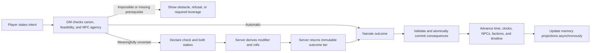
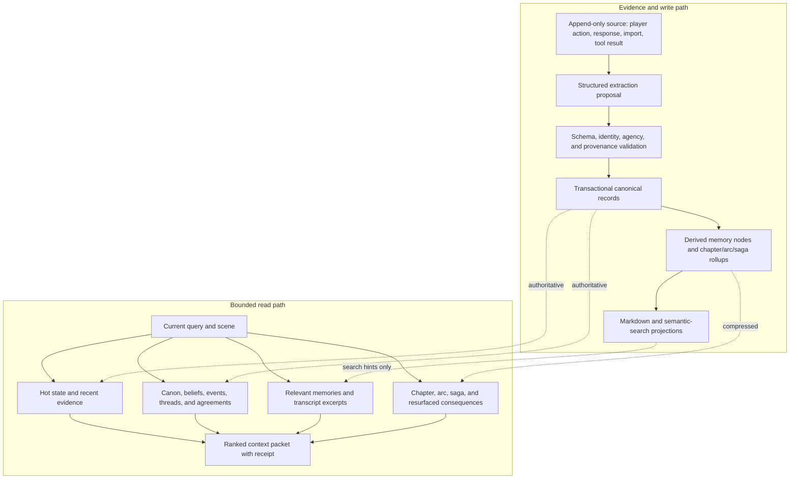

# Narrative d20 and Portable Memory Architecture Design

Date: 2026-08-16
Status: proposed for implementation

## Purpose

Mtherios should support D&D-style uncertainty, resistance, and lasting consequences without becoming a full D&D 5e simulator. The recommended solution is an optional **narrative d20** rules layer built on the systems that already exist: canonical entities, NPC beliefs, server-side dice, story meters, timeline events, Plot Director pressure, and evidence-backed memory.

This document also records the memory architecture as a portable design. Its useful core is not specific to roleplay: append evidence, promote validated canon, condense it at several resolutions, retrieve only what matters now, and treat human-readable and vector indexes as rebuildable projections.

## Decision

Build one opt-in rules mode with this loop:

```text
player intent
  -> feasibility and agency gate
  -> declared ability, difficulty, and stakes
  -> bounded server-side d20 roll
  -> degree of outcome
  -> narration
  -> validated canonical consequences
  -> time, clocks, NPCs, factions, and Plot Director react
```

Do not build classes, levels, spell catalogs, encounter grids, or a D&D-compatible rules encyclopedia for the first version.

## Non-Negotiable Invariants

1. Player text states an attempted action, not its successful outcome.
2. The GM owns feasibility, consequences, NPC speech, NPC action, refusal, consent, and counteroffers.
3. The model may request a bounded check, but it may not invent a modifier, die result, canonical condition, or committed consequence.
4. Impossible actions and actions that violate another character's agency do not become possible on a natural 20.
5. A social check can change terms, patience, price, access, disclosure, or confidence. It cannot erase a belief, red line, duty, fear, or relationship history without corresponding fictional leverage.
6. Every durable change points back to evidence such as an entry, event, roll, or accepted patch.
7. Postgres canon remains authoritative. Markdown, cached prompt packets, embeddings, and Qdrant are projections that can be rebuilt.
8. Existing stories remain unchanged unless the rules mode is enabled.

## Why This Fits Mtherios

The application already has most of the substrate:

- `roll_check` and server-side dice execution.
- Flexible canonical character state in `entities.state`.
- NPC beliefs, relationships, agreements, factions, story threads, and scheduled events.
- Story meters suitable for danger, suspicion, progress, exhaustion, and faction clocks.
- Plot Director pressure cards and a GM timeline.
- Source-linked entries, facts, events, memory nodes, chapters, arcs, sagas, and checkpoints.
- Hybrid retrieval with bounded prompt assembly and graceful text fallback when semantic search is unavailable.

The missing part is a trusted adjudication contract. Today a model can supply arbitrary dice notation, modifier, and DC. The first implementation should harden that seam before adding more mechanics.

## Narrative d20 V1

### Story Configuration

Store an opt-in configuration in the existing JSON story settings. No database migration is required.

```ts
type NarrativeD20Settings = {
  mode: 'off' | 'narrative-d20';
  showRolls: 'cinematic' | 'tabletop';
  useDegreesOfOutcome: true;
};
```

`off` preserves the current narrative path. `narrative-d20` enables canonical sheets, bounded checks, conditions, and clocks.

### Compact Character Mechanics

Store an optional versioned block under `entities.state.rpg`. It is deliberately smaller than a 5e character sheet.

```ts
type NarrativeD20Character = {
  version: 1;
  abilities: {
    str: number;
    dex: number;
    con: number;
    int: number;
    wis: number;
    cha: number;
  };
  proficiencyBonus: number;
  skills?: Partial<Record<Skill, 0 | 1 | 2>>;
  inspiration?: number;
  conditions?: Array<{
    id: string;
    label: string;
    effect: string;
    expires?: string;
    sourceEntryId: string;
  }>;
  health?: { current: number; max: number };
  resources?: Record<string, { current: number; max: number }>;
};
```

Ability modifiers are derived from scores. Skill rank means untrained, proficient, or expert. Health and resources are optional so a political or romantic campaign does not acquire combat bookkeeping it does not need.

V1 uses a closed skill set so schema validation and ability mapping are deterministic:

```ts
type Skill =
  | 'athletics'
  | 'acrobatics' | 'sleight-of-hand' | 'stealth'
  | 'arcana' | 'history' | 'investigation' | 'nature' | 'religion'
  | 'animal-handling' | 'insight' | 'medicine' | 'perception' | 'survival'
  | 'deception' | 'intimidation' | 'performance' | 'persuasion';
```

The shared rules module maps Athletics to Strength; Acrobatics, Sleight of Hand, and Stealth to Dexterity; the five knowledge skills to Intelligence; the five awareness/care skills to Wisdom; and the four social skills to Charisma. A story can display different labels later, but it cannot change the canonical mapping in V1.

### Check Request

Replace free-form notation and modifiers in narrator-initiated checks with a bounded semantic request:

```ts
type NarrativeCheckIntent = {
  actorEntityId: string;
  ability: 'str' | 'dex' | 'con' | 'int' | 'wis' | 'cha';
  skill?: Skill;
  difficulty: 'easy' | 'moderate' | 'hard' | 'very-hard';
  difficultyBasisSourceIds?: string[];
  edge: 'disadvantage' | 'normal' | 'advantage';
  edgeReason?: string;
  edgeSourceIds?: string[];
  purpose: string;
  successStake: string;
  failureStake: string;
  timeCost?: string;
};

type NarrativeCheckRequest = NarrativeCheckIntent & {
  requestId: string;
};
```

The model-facing tool accepts `NarrativeCheckIntent`. `requestId` is internal and is not authored by the model. The turn executor derives it from the reserved story/client-turn id and normalized tool-call ordinal. Before drawing randomness, it reserves that id in the existing `sync_ops` table. A retry returns the stored result; a concurrent duplicate cannot roll again. This is stronger than relying on JSON entry metadata for uniqueness.

The server maps difficulty to fixed DCs of 10, 15, 20, and 25; loads the actor's canonical sheet; derives the modifier; validates skill proficiency and cited edge sources; rolls exactly one d20 or two for advantage/disadvantage; and returns an immutable result. It rejects unknown actors, missing sheets, invalid combinations, excessive modifiers, or repeated resolution of the same request id.

Difficulty selection remains a bounded GM judgment, as it is at a tabletop. The policy makes that judgment visible and auditable:

- Moderate is the default for a meaningful uncertain action.
- Easy requires established leverage or a weak obstacle.
- Hard requires a trained opposition, serious adverse conditions, or another explicit canonical obstacle.
- Very hard requires an extraordinary canonical obstacle.
- Every non-default tier cites the entity, condition, event, item, belief, or scene source that justifies it.
- Advantage or disadvantage requires at least one canonical source; conflicting sources cancel.
- An opposed check derives its numeric DC from the opposing canonical sheet rather than asking the model for a tier.

Code can verify ids, types, bounds, and opposed-sheet math. It cannot fully judge whether prose semantically deserves a hard DC, so the request, cited sources, and final DC must appear in the debug receipt. A later referee may audit that judgment, but V1 should not introduce another agent to make the same subjective choice.

NPC beliefs and red lines are evaluated before any numerical check.

### Feasibility Gate

Before requesting a roll, the GM must classify the action:

- **Automatic:** established capability and no meaningful adverse outcome. Narrate it without a roll.
- **Uncertain:** success and failure are both plausible and materially different. Declare stakes, then roll.
- **Impossible or agency-invalid:** explain the obstacle or refusal. Do not roll.
- **Missing prerequisite:** reveal what leverage, position, tool, permission, or information would make an attempt possible.

This is the main defense against “anything can happen.” A die resolves uncertainty inside the fiction; it does not replace the fiction.

### Degrees of Outcome

Use the roll margin to avoid flat pass/fail prose:

| Result | Mechanical meaning | Narrative use |
| --- | --- | --- |
| Selected natural 20 | Critical success inside the feasible ceiling | Strong effect, reduced cost, or useful opening |
| Total at least DC + 5 | Strong success | Full intent plus an advantage |
| Total at least DC | Success | Intent succeeds at the declared cost |
| Total from DC - 4 to DC - 1 | Progress with setback | Partial progress, cost, delay, exposure, or hard choice |
| Total below DC - 4 | Failure | Failure stake occurs and the situation changes |
| Selected natural 1 | Critical failure inside plausible consequences | Serious complication, never arbitrary humiliation |

After advantage/disadvantage selects the natural die, natural 20 and natural 1 take precedence over total-based tiers. A natural 20 remains bounded by the feasibility ceiling; a natural 1 cannot create a consequence that was absent from the declared failure stake. The narrator receives the immutable tier and declared stakes. It may dramatize them, but it may not silently upgrade failure or nullify success.

### Social Resolution and NPC Agency

For every consequential NPC, current canon should provide:

- What they want now.
- What they fear losing.
- What evidence they believe.
- Their relationship posture toward the player.
- A current ask or counteroffer.
- Red lines they will not cross under current conditions.
- Leverage that could plausibly move them.

The feasibility gate computes an outcome ceiling before a social roll. Examples:

- A good result may earn a private audience, not instant loyalty.
- Intimidation may produce short-term compliance while increasing resentment or a danger clock.
- Persuasion may reduce a price, reveal one fact, or produce a conditional promise.
- Attraction, forgiveness, trust, ideology, and consent require fictional development rather than one high roll.

When a consequential request is contested by the NPC's goals, beliefs, duties, fears, or costs, the response should preserve that resistance through a demand, refusal, condition, counteroffer, price, delay, deception, or independent action. Plain agreement is correct when current canon and incentives genuinely support it. The aim is grounded agency, not mandatory friction.

### Clocks, Pressure, and Time

Reuse story meters as clocks rather than creating a second progress system. Examples include `Guard Suspicion`, `Ritual Completion`, `Faction Patience`, `Injury`, and `Escape Route`.

- A check result may tick a clock by a validated amount.
- Thresholds schedule or reveal story events.
- Time-consuming attempts advance world time even when they fail.
- Plot Director may propose fronts and pressure beats, but only adjudicated play or an accepted world-simulation change advances a canonical clock.
- The GM timeline surfaces due consequences until they occur or are explicitly retired.

### Persistent Consequences

Extend the structured world update with a narrow `rpg_changes` section:

```ts
type RpgChanges = Array<{
  entityId: string;
  healthDelta?: number;
  resourceDeltas?: Record<string, number>;
  addConditions?: Array<{ label: string; effect: string; expires?: string }>;
  removeConditionIds?: string[];
}>;
```

The server must resolve existing canonical ids, clamp values, add provenance, validate expiration, and commit the roll record and consequences atomically. Narrator prose alone never changes a sheet.

Rolls should initially be stored in story-entry metadata and, when consequential, projected into a story event. A new roll table is unnecessary until querying or analytics prove that entry metadata is insufficient.

### User Experience

V1 needs only three visible additions:

1. A compact inline check card showing ability/skill, edge, derived modifier, DC, natural roll, total, and outcome tier.
2. A small mechanics section on the existing character/world sheet for abilities, conditions, inspiration, and optional health/resources.
3. A story setting for `Off`, `Narrative d20 — cinematic`, or `Narrative d20 — show the math`.

The normal action box remains free text. The system decides when uncertainty warrants a check; the player does not need to write commands.

## Turn Contract



## Implementation Plan

### Phase 0: Harden Existing Seams

- Bound dice count, sides, modifier, DC, and input length in the generic dice parser.
- Make narrator checks use exactly d20 semantics; fix critical handling so summed multi-d20 rolls cannot be treated as a natural 20.
- Stop accepting narrator-supplied canonical modifiers.
- Add an idempotent check request id so retries cannot roll twice.
- Verify terminal/server application parity for `meter_changes`, `player_ledger`, and item location fields before mechanics rely on them.

### Phase 1: Small Playable Slice

- Add opt-in story settings and `entities.state.rpg` validation.
- Replace the narrator `roll_check` contract with the bounded semantic request.
- Add feasibility, social-ceiling, stake, and outcome-tier prompt contracts.
- Persist the immutable result with its entry.
- Render the compact roll card.
- Cover server and browser/local narration paths with the same rules.

This phase alone should make uncertain actions feel much more like tabletop roleplay.

### Phase 2: Consequences and Clocks

- Add validated `rpg_changes`.
- Connect story-meter thresholds to timeline events.
- Add condition display and expiration by turn, scene, rest, or explicit event.
- Add inspiration/favor spending as small, canonical resources.

### Phase 3: Relationships and Downtime

- Make NPC asks, red lines, leverage, and relationship posture first-class context fields.
- Add downtime actions for recovery, investigation, crafting, training, and faction work.
- Let downtime advance world simulation and opposing clocks.

### Phase 4: Optional Theater-of-Mind Encounters

Only if playtests demand it, add a compact encounter object with participants, initiative order, round, active participant, zones/ranges, and objectives. Continue using canonical entity health and conditions.

Do not add a battle map, hundreds of spells, monster stat-block imports, multiclass rules, or action-economy edge cases until the narrative loop is demonstrably fun and those features solve observed problems.

## Portable Memory Architecture

### Scope: Implemented Foundation and Portable Target

This section distills the current Mtherios foundation into a target pattern for reuse. It does not claim that every portability invariant is complete today.

| Status | Capability |
| --- | --- |
| Implemented | Postgres story entries and structured records; source ids and source references; separate NPC beliefs; canonical events and relationships; memory nodes; chapter/arc/saga records; hybrid structured/lexical/semantic retrieval; bounded prompt assembly; Markdown and vector projections; job state and turn debug snapshots |
| Implemented with limits | Retrieval receipts and dependency-aware caches cover the main server path but not every static debug view; summaries are source-linked but canon is not fully event-sourced; relational `story_entries` are turn evidence while the campaign vault's append-only `raw/` layer is a separate evidence archive/projection |
| Target hardening | Durable continuity-repair proposals, automatic saga rollup, ACL-aware vault/index projections, complete canonical table import/export coverage, and consistent freshness telemetry across every projection |

### The Reusable Idea

The memory system is strong because it separates **what happened**, **what is currently true**, **what was summarized**, and **how information is found**. Those are different responsibilities and can fail independently without corrupting canon.



### Memory Layers

| Layer | Purpose | Typical records | Authority |
| --- | --- | --- | --- |
| Evidence | Preserve what was actually observed or generated | Transcript entries, imports, tool results, roll records | Append-only or explicitly versioned evidence |
| Hot canon | Answer “what is true now?” cheaply | Story state, entities, current location, inventory, beliefs, agreements, open threads, due events | Authoritative |
| Canonical event ledger | Preserve authoritative events and relational consequences | Story events, facts, relationship changes | Authoritative |
| Episodic retrieval memory | Preserve compact event recollections for ranking and recall | Memory nodes | Derived and source-linked |
| Condensed memory | Maintain long-horizon consequence chains | Chapters, arcs, sagas | Rebuildable summaries |
| Recovery snapshots | Restore a known canonical context version | Context checkpoints | Authoritative recovery artifact, not a summary tier |
| Search projection | Find candidate evidence at scale | Markdown vault, lexical index, pgvector/Qdrant embeddings | Never authoritative |
| Context packet | Give one model only what this task needs | Ranked, visibility-filtered, token-bounded excerpts | Ephemeral |

The essential design choice is that exact live mechanics and current entity state come from hot canon. Vector search can suggest an old event, but it must never decide current health, inventory, consent, a clock value, or whether a promise was fulfilled.

### Write Pipeline

1. Append the raw source with a stable workspace/story id, sequence, timestamp, actor, and visibility.
2. Ask a model or deterministic parser for structured proposals. A proposal is not canon.
3. Resolve identities against canonical ids and aliases.
4. Validate schemas, ownership, agency boundaries, version, and allowed fields.
5. Commit accepted records transactionally and attach source references.
6. Derive memory nodes, event links, and changed dependency hashes.
7. Build chapter summaries, then roll chapters into arcs and arcs into sagas. Save context checkpoints independently when rollback protection is required.
8. Refresh human-readable Markdown and semantic indexes asynchronously.

If extraction, summarization, wiki projection, or embedding fails, the evidence and canon remain intact and the failed projection can be retried.

### Read Pipeline

1. Start with the current query, named entities and aliases, current location, open threads, and relevant time window.
2. Load exact hot canon and recent transcript evidence.
3. Retrieve candidates from memory nodes, beliefs, events, transcript excerpts, and optional wiki/vector indexes.
4. Filter by workspace/story, visibility, status, identity, and temporal validity.
5. Rank by direct entity match, thread/location overlap, importance, recency, lexical relevance, and semantic relevance.
6. Select recent consequences, query-relevant callbacks, pinned canon, and a very small deterministic sample of old unresolved consequences.
7. Enforce per-section and total token budgets, preserving source ids and a retrieval receipt.
8. Put the packet below current instructions and player intent so retrieved text cannot masquerade as a command.

This combines precision with graceful degradation: if vector retrieval is unavailable, identity, lexical, recency, and source-linked retrieval still work.

### Portable Record Contract

A reusable implementation needs only a small neutral contract:

```ts
type SourceRecord = {
  workspaceId: string;
  sourceId: string;
  sequence: number;
  occurredAt?: string;
  kind: string;
  body: string;
  actorIds?: string[];
  subjectIds?: string[];
  visibility: string;
  metadata?: Record<string, unknown>;
};

type CanonRecord = {
  workspaceId: string;
  recordId: string;
  type: string;
  state: Record<string, unknown>;
  version: number;
  status: string;
  visibility: string;
  effectiveAt?: string;
  updatedAt: string;
  sourceIds: string[];
};

type MemoryDigest = {
  workspaceId: string;
  memoryId: string;
  level: 'event' | 'chapter' | 'arc' | 'saga';
  summary: string;
  subjectIds: string[];
  threadIds: string[];
  importance: number;
  visibility: string;
  status: 'active' | 'superseded' | 'invalidated';
  version: number;
  sequenceFrom: number;
  sequenceTo: number;
  createdAt: string;
  updatedAt: string;
  sourceIds: string[];
  supersedes?: string[];
  invalidatedByVersion?: number;
};
```

Storage engines, embedding providers, Markdown projectors, and model vendors are adapters around this contract. They are replaceable. The invariants are provenance, authority, visibility, versioning, bounded retrieval, and rebuildability.

### Reuse Examples

| New product | Evidence | Canon | Condensed memory | Retrieval focus |
| --- | --- | --- | --- | --- |
| Support assistant | Messages, calls, ticket updates | Customer, product, entitlement, incident state | Case summary and account history | Current issue, product, prior fixes, promises |
| Research workspace | Papers, notes, datasets | Sources, claims, entities, confidence | Topic synthesis and project review | Claim, citation, contradiction, date |
| Project copilot | Commits, tasks, chats, decisions | Components, owners, decisions, risks | Milestone and release summaries | Current task, dependency, prior decision |
| Personal knowledge system | Notes, mail, calendar events | People, projects, commitments, preferences | Weekly/monthly digests | Person, project, deadline, unresolved promise |

For each reuse, rename the domain records but preserve the same flow: evidence -> validated canon -> multi-resolution memory -> bounded retrieval -> rebuildable projections.

### What to Copy

- Append-only evidence with stable ids and ordering.
- Canonical records with explicit source links.
- Identity and alias resolution before writes or retrieval.
- Visibility and secret handling at storage and retrieval boundaries.
- Transactional validation for durable changes.
- Several summary resolutions instead of one ever-growing summary.
- Query-centered transcript excerpts and entity/thread/location-aware ranking.
- Strict context budgets and receipts that explain what was included.
- Human-readable exports and semantic indexes that can be regenerated.
- Checkpoints, idempotent jobs, retryable projections, and repair tooling.

### What Not to Copy

- Fantasy-specific character or faction fields.
- Narrator prompt prose as architecture.
- A vector database as the source of truth.
- Full transcripts in every prompt.
- Silent model writes directly into canon.
- Summaries without source ids.
- One global memory pool without workspace and visibility boundaries.
- Retrieval that treats quoted or retrieved text as current instructions.

### Failure Modes and Required Fallbacks

| Failure | Safe behavior |
| --- | --- |
| Structured extraction returns blank or malformed output | Keep evidence, apply nothing, record a retryable failure |
| Entity identity is ambiguous | Create a review proposal or unresolved reference; do not mutate a guessed entity |
| Summary job fails | Continue from raw evidence and existing canon; retry asynchronously |
| Vector/embedding provider is unavailable | Fall back to aliases, lexical matching, recency, importance, and links |
| Markdown/wiki projection is stale | Read canonical database state and mark projection stale |
| Context exceeds budget | Rank and compact by section; keep current instructions, scene, and final action boundaries |
| A cached packet has changed dependencies | Invalidate it using dependency/version hashes |
| A write is retried | Reuse its command/idempotency key and return the already-committed result |
| Secrets exist | Filter before ranking and prompt rendering, not after generation |

### Current Mtherios Gaps to Fix or Account For

These do not invalidate the pattern, but they matter when reusing the current implementation:

- The unresolved continuity proposal hook is currently a no-op. Ambiguous extraction can produce a warning without producing a durable repair proposal.
- Normal narration intentionally excludes repair-only facts, patch proposals, and continuity warnings. A new product must decide which audit knowledge belongs in its normal working context.
- Chapter and arc rollups are automated; saga rollup is not yet an equivalent automatic job.
- The local story vault can contain GM-secret beliefs, events, and memories. A multi-user reuse needs ACL-aware projection and indexing, not only prompt-time hiding.
- Vault freshness and vector-index freshness are separate. A fresh Markdown projection does not prove the semantic index is current.
- The static prompt-packet debug route does not reproduce every live wiki and scene injection. The executed turn snapshot is the stronger diagnostic record.
- The terminal world-database table ordering omits sagas even though import/export otherwise supports them. Portability tests should cover every canonical table explicitly.
- Background projection failures do not block narration, which is good, but failed jobs and stale markers still need monitoring and repair controls.

### Observability

Every generated context packet should expose a receipt containing:

- Source ids and memory ids selected.
- Reason for selection: current, exact entity, thread, location, lexical, semantic, pinned, or resurfaced.
- Visibility decision.
- Tokens requested, selected, clipped, and omitted by section.
- Cache hit/miss and dependency versions.
- Semantic-search status and fallback reason.

That receipt makes “the model forgot” diagnosable as a write, projection, retrieval, ranking, clipping, or prompt-placement problem.

## How d20 Results Use Memory

- A roll record is append-only evidence.
- Current health, resources, conditions, and clocks are exact hot canon.
- Consequential results become source-linked events and state changes.
- Chapter summaries preserve the decision, consequence, cost, and unresolved pressure, not every die calculation.
- Old roll details are retrieved only when the exact event or its consequence matters.
- NPC beliefs update from what that NPC could perceive, not from omniscient narration.
- Plot Director reads committed consequences and open pressures; it does not rewrite a roll or activate an uncommitted draft as canon.

## Acceptance Criteria

### Narrative d20

- The model cannot supply or override a canonical modifier or die result.
- Impossible and agency-invalid actions produce no roll.
- Both stakes are visible before resolution and cannot be rewritten afterward.
- Natural 20 respects the feasible outcome ceiling.
- Failure changes the situation rather than being softened into success.
- NPC refusal and counteroffers are grounded in stored beliefs, goals, leverage, and red lines.
- The result and every persistent consequence share evidence ids and commit atomically.
- Story meters and timeline consequences behave the same in server and browser/local paths.
- With rules mode off, existing story behavior and data remain compatible.

### Portable Memory

- Canon can be audited against source-linked evidence; rebuildability is guaranteed for projections, not for every canonical mutation.
- A vector outage does not prevent usable context assembly.
- Retrieval never crosses workspace or visibility boundaries.
- Current exact state wins over summaries and search projections.
- Long histories fit within explicit budgets without losing current scene or open consequence chains.
- Markdown and semantic indexes can be deleted and regenerated from canon.
- A context receipt explains why each major memory was included or omitted.

## Recommended First Slice

Implement only Phase 0 and Phase 1 first. That produces the largest behavioral change with the least new machinery:

1. Harden d20 bounds and retry semantics.
2. Add the small opt-in character mechanics block.
3. Replace free-form checks with server-derived modifiers and declared stakes.
4. Enforce feasibility and social outcome ceilings.
5. Persist and display the immutable result.

Then playtest several social, exploration, and dangerous physical scenes. Add conditions and clocks only after the core adjudication loop consistently produces resistance, tradeoffs, refusal, partial progress, and earned success.

## Related Project Documents

- [`VISION.md`](../../../VISION.md) for game feel, causal fiction, and the living-world model.
- [`PROJECT_ABOUT.md`](../../../PROJECT_ABOUT.md) for the storage model and event-based world memory.
- [`ARCHITECTURE.md`](../../../ARCHITECTURE.md) for current service and data-flow orientation.
- [`docs/local-wiki-core.md`](../../local-wiki-core.md) for the standalone vault and authority boundary.
- [`docs/superpowers/plans/2026-06-02-node-event-timeline-engine.md`](../plans/2026-06-02-node-event-timeline-engine.md) for scheduled canonical events.
- [`docs/superpowers/plans/2026-07-06-strategic-plot-brain.md`](../plans/2026-07-06-strategic-plot-brain.md) for strategic pressure and Plot Director reuse.
- [`docs/superpowers/specs/2026-06-22-small-brain-service-design.md`](2026-06-22-small-brain-service-design.md) for the proposal-only model boundary.
